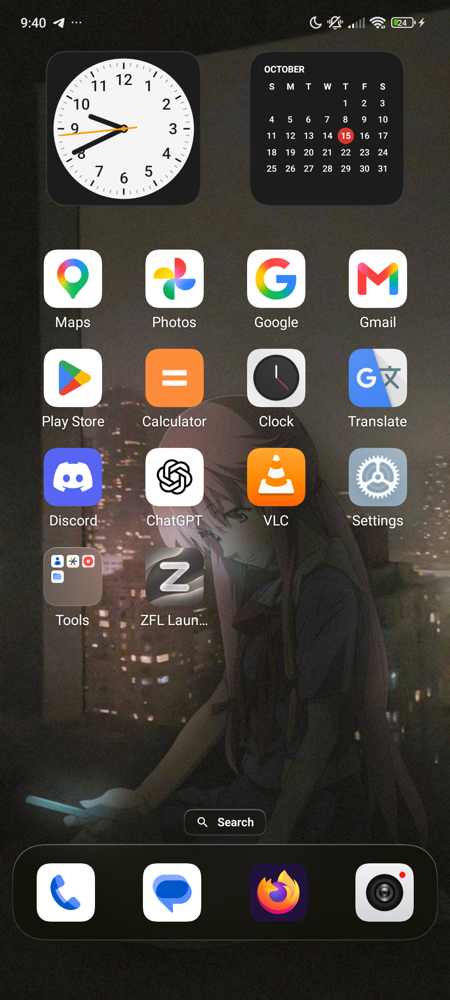
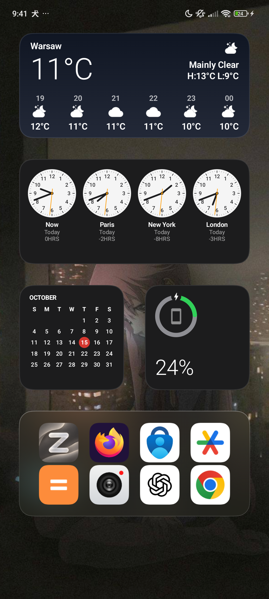
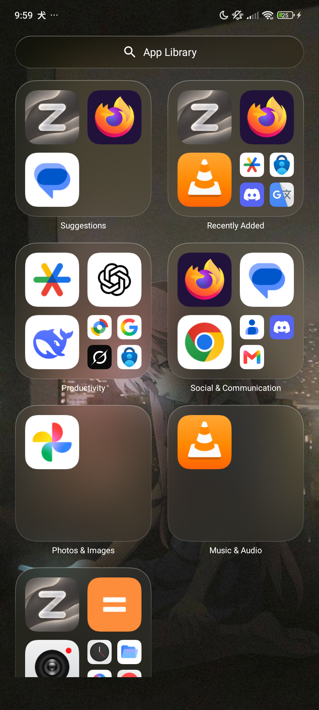
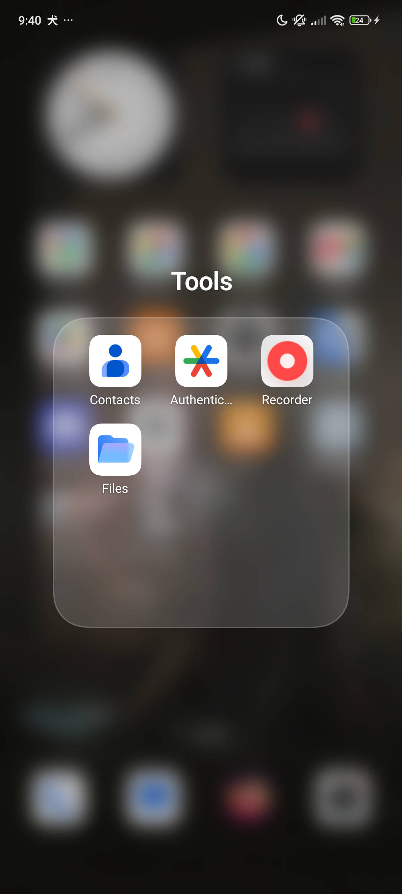
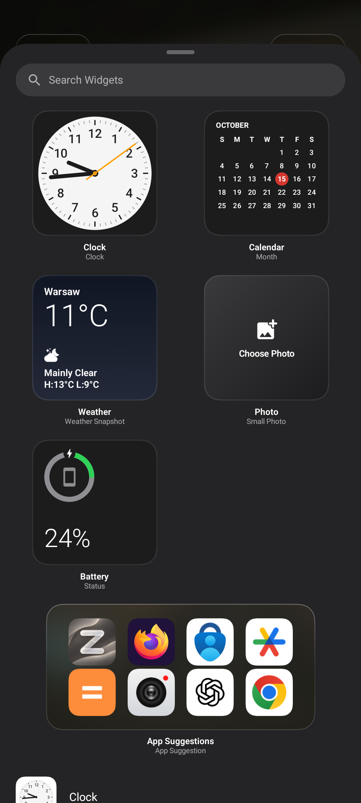
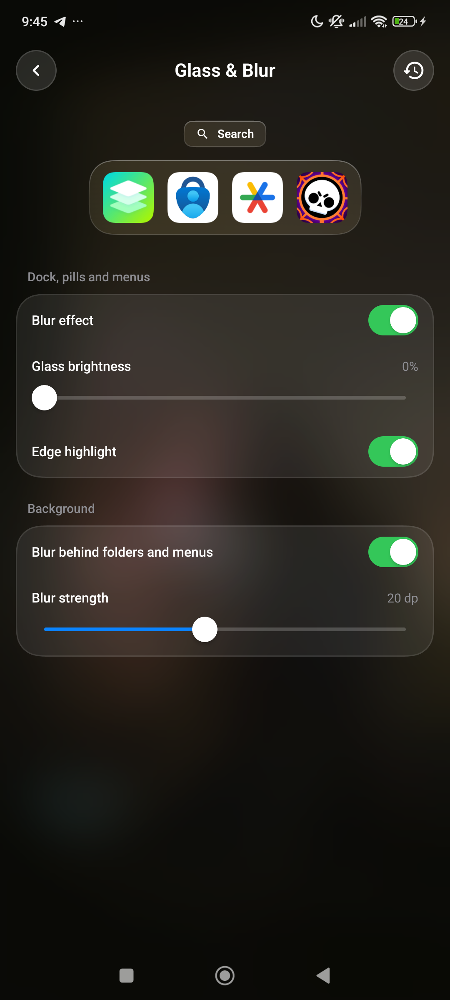
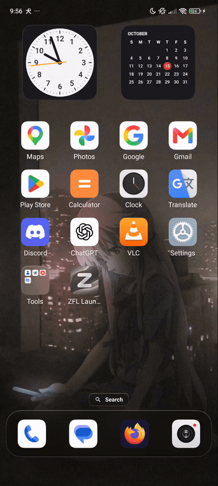
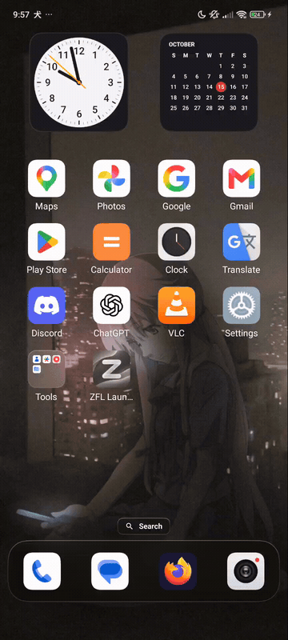
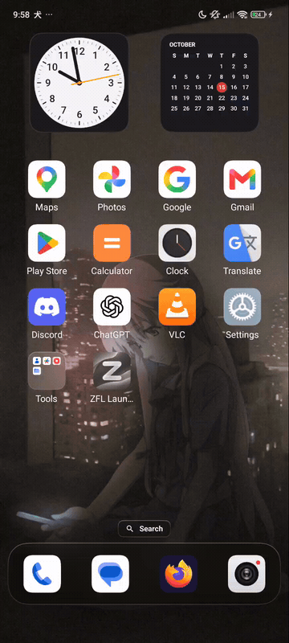
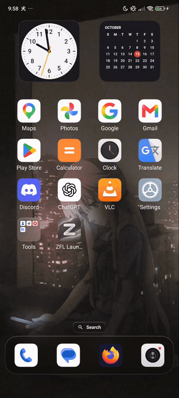

<p align="center">
  
</p>

<h1 align="center">ZFL Launcher</h1>

<p align="center">
  <strong>Zero-Fee Launcher</strong>
  A free, open-source Android launcher with an elegant, iOS-inspired home screen.<br>
  Frosted glass, soft corners, and room to make it yours. No ads. No tracking.
</p>

## A familiar frustration

You find an iOS-style launcher that looks beautiful in screenshots. You install it,
arrange your apps, and try to settle in. Then come the ads, the awkward workarounds,
the glitches, and the crashes. It works—until it doesn't. Sound familiar?

ZFL started with that same frustration. Built by someone tired of the same things
you are, it aims to make a beautiful home screen feel like a comfortable part of
your phone. A launcher is something you use every day; it should be dependable,
pleasant, and leave you alone to enjoy it.

**ZFL stands for Zero-Fee Launcher.** Free to use, open to explore, and built without
ads or trackers. It brings the visual character of iOS to your Android home screen:
translucent glass, softly rounded icons, and familiar ways to organize your apps.

The project is still in early development. There is more to polish, and reliability
is a goal we keep working toward.

## Make yourself at home

- **A softer look.** Frosted glass surfaces, rounded icons, and a translucent dock
  give your wallpaper room to shine.
- **Your own arrangement.** Move apps between pages, keep favorites in the dock,
  and bring related apps together in folders.
- **Apps within reach.** Find an app through home screen search or browse the
  App Library when you want to see everything.
- **Useful little details.** Add clocks, calendars, photos, weather, or widgets
  from your installed apps.
- **Personal touches.** Customize icons, labels, and page transitions to make the
  home screen feel like yours.

## On a real phone

Captured on a POCO X5

<table>
  <tr>
    <td align="center"><br>Home screen</td>
    <td align="center"><br>Today widgets</td>
    <td align="center"><br>App Library</td>
  </tr>
  <tr>
    <td align="center"><br>Folders</td>
    <td align="center"><br>Widget gallery</td>
    <td align="center"><br>Make it yours</td>
  </tr>
</table>

Explore the [full screenshot gallery](etc/README.md) for search, menus, editing,
widget sizes, and settings.

### Page transitions

Five ways to move between your home screen pages, recorded on the same phone.

<table>
  <tr>
    <th>Default</th><th>Rotation</th><th>Flip</th><th>Zoom In</th><th>Alpha</th>
  </tr>
  <tr>
    <td></td>
    <td></td>
    <td></td>
    <td></td>
    <td></td>
  </tr>
</table>

[Watch the 60 fps videos](etc/README.md#page-transitions) for smoother playback.

## Gestures and Home

Open **Settings → Gestures and Home**. Swipe up, swipe down, double tap on empty
space and pressing Home again each have a saved assignment. Choose no action,
Search, App Library, an installed app (activity and profile), or Settings. Repeat
Home also offers **Main home page**. App Library is offered only while its page
is enabled; disabling the page later preserves its assignment and shows it as
unavailable. It does not enable itself again.

| Setting | Default |
| --- | --- |
| Swipe down | Search |
| Swipe up / empty-space double tap | No action |
| Repeat Home | Main home page |
| Return from a launched app | Keep the current page |
| Main home page | First home page |
| Today / launcher haptics | Enabled |

Reset on this settings screen restores these defaults. Existing search direction
settings migrate once: Down assigns Search only to swipe down, Up only to swipe
up, Disabled to neither. The older swipe-down boolean is honored when no valid
direction was saved. New assignment keys win, including unknown values (which
safely behave as No action). Legacy keys are removed after migration.

Home closes the top menu, dialog, editor, search, folder or edit mode before any
Repeat Home action can run. A separate Home press on the exposed desktop runs the
assignment once. **No action** leaves the page as it is. Return navigation and the
existing return animation are separate from Repeat Home: returning from a launched
app follows the chosen return policy; Settings and permission-screen resumes do
not become repeat presses. A background HOME Intent also follows the return policy.

The main page is a home-page ordinal, independent of Today and the library. If that
page disappears, its ordinal is clamped to the nearest existing home page (or the
first if none remain). This does not reorder apps or save the layout while paging.
Hiding Today removes its UI from the pager while preserving its saved widgets,
photos and hosted widget IDs, including stack contents. Re-enabling it restores
them. Disabling a page while viewing it selects the main home page.

| Input priority | Owner |
| --- | --- |
| Open overlay/editor, active drag, edit mode | Existing local interaction; global assignments disabled |
| Horizontal axis after touch slop | Home pager |
| Vertical gesture on scrollable hosted content | The widget |
| Other vertical gesture on a Smart Stack, including its edges | The stack |
| Remaining vertical page gesture | Assigned swipe |
| Double tap outside all occupied grid spans | Empty-space assignment |

The swipe region remains the home page, including icons where the child does not
consume the drag. An axis locks after system touch slop. After crossing the existing
swipe threshold, an action runs once on release; consumed sequences, extra fingers,
cancellation, focus loss and removal of the handler invalidate it. An ordinary app
tap does not wait for a double-tap timeout.

App targets retain the exact component and profile, never a label or arbitrary
Intent URI. Missing apps and unavailable profiles do nothing; the assignment stays
visible and can be replaced or reset. Targets are checked again by LauncherApps
before launch. Haptics controls ZFL's lift, tick, threshold and switch feedback,
including the long press created by its widget host; platform haptic preferences
still apply. It does not control vibration inside another app or widget.

## Island

**Settings → Island** enables an optional music capsule above other apps. It is off
on fresh installs and updates. Grant **Display over other apps** and **Notification
access for music** using the buttons on that page. Returning from a permission
screen rechecks the actual grants; leaving or cancelling the screen grants nothing.
The music button opens Android's special notification-access list. On Android 13+
an APK installation can additionally be blocked by Restricted Settings; this must
be allowed in the system's app information UI before notification access can be
enabled. ZFL cannot grant this access itself.
Charging events also require the music listener to be connected.

The system-bound `IslandListenerService` owns a single `TYPE_APPLICATION_OVERLAY`
window, independently of Home. No foreground service or background Activity launch
keeps it alive. With Island off, it has no media subscriptions, receivers or window.
The system and OEM control listener binding; force-stop and battery restrictions
are respected, so automatic startup is not guaranteed.

Compatible platform MediaSessions provide the artwork, title, artist, playback
state and supported play/pause/previous/next controls. Sessions retain their token
identity, including multiple sessions from one player. Playing sessions take
priority; within a priority the current session is retained. Paused music remains
for 30 seconds. Tap the capsule to expand; use the collapse button or wait 12 seconds.
Seek is enabled only with a known position, duration and seek action. Otherwise a
known position is an indicator. Tapping the artwork/title opens the player only
when its session provides an Activity PendingIntent; Android launch restrictions
still apply, and a platform-blocked launch may not report a failure to ZFL.

Optional charging indication shows a new unplugged-to-plugged transition for four
seconds. The initial battery snapshot is a baseline, and repeated broadcasts do
not extend it. Charging cannot interrupt expanded music controls. Screen off,
Keyguard, disabled settings and revoked access remove the window and cancel delayed
presentation. Unlock starts compact with live data. Runtime data is not saved.

The window stays below the status bar/cutout, leaves other apps focused, and uses
only the bounds of the capsule/card. Collapse is explicit or timed; there is no
full-screen outside-touch catcher. Landscape uses the compact presentation;
insufficient space hides Island. Apps that hide overlays and protected system
surfaces remain outside its control.

Island reuses ZFL's glass contour and highlight with a readable translucent dark
body. It does not sample wallpaper or capture/blur another app. Artwork is limited
to an owned 192-pixel thumbnail (at most 144 KiB of ARGB pixels), decoded off the
main thread from session bitmaps; artwork URIs are never loaded. Only visible,
expanded progress ticks at 1 Hz while playback advances. No sensor or animation
loop runs in a settled capsule.

The first implementation has JVM policy/regression coverage, but its Android
window lifecycle, player interoperability, touch behavior, morph appearance and
idle/frame performance still require validation on a connected device. It does
not integrate calls, messages, navigation, third-party timers or other notifications.

## Privacy comes with it

No advertising SDKs, trackers, analytics, crash reporters, Firebase, or Google Play
Services. Your layout and settings are stored on your phone.

The optional weather feature uses Open-Meteo for city searches and forecasts,
sending the city query or forecast coordinates needed for those requests. It needs
no account or API key. Choosing **Current Location** requires approximate location
access; you can choose a city manually instead. Web searches open in an external app.

On Android 13+, wallpaper blur needs **All files access** to read the wallpaper
bitmap. ZFL uses that permission only for the wallpaper; it does not scan, read,
or write your personal files. Without it, glass surfaces use a translucent tint.
Calendar access is requested when you choose to show upcoming events in a widget.
Island's optional notification access is used only to query/control MediaSessions;
notification delivery types are filtered out and ordinary notification payloads
are not read. It stores no tracks, session tokens, PendingIntents or artwork, and
does not use the network. Overlay access is used only for the Island window.

## Try it

ZFL runs on **Android 12 or newer**. To build it, use JDK 17 and the Android SDK,
or open the project in Android Studio. With your Android device connected, run:

```bash
./gradlew :app:installDebug
```

Press Home and choose **ZFL Launcher** as your home app.

### Build modes

- `./gradlew :app:assembleDebug` keeps debugging and Compose tooling available,
  skips R8, resource shrinking, and PNG crunching. Gradle caches task outputs and
  configuration for repeated builds; avoid `clean` during normal development.
- `./gradlew :app:assembleRelease` enables R8 full mode with strict keep rules,
  code shrinking, obfuscation, optimization, integrated resource shrinking, and
  PNG crunching. Classes may be repackaged and access widened for optimization.
  Release also removes Kotlin Intrinsics null checks: invalid nulls passed from
  Java/platform code may fail later, or no longer fail at the original boundary.
  Debug retains those checks. See the [R8 global options](https://developer.android.com/topic/performance/app-optimization/global-options).

The R8 modes above are already defaults in AGP 9.4; the project pins them
explicitly. Dependency keep rules and release stack-trace mapping are retained.
The release APK currently uses the development debug signing key.

Gradle uses up to two workers and the Kotlin daemon has a 1 GiB heap limit to
bound memory use. On a larger machine, override these in your user-level
`~/.gradle/gradle.properties` or use `--max-workers=4`.

## Help shape ZFL

Bug reports, thoughtful suggestions, translations, and pull requests are welcome.
If something feels awkward or breaks in everyday use, that is worth fixing.

For code contributions, keep comments and identifiers in English and put interface
text in `res/values/strings.xml`, with translations in `values-xx/`. Preserve the
project's privacy principles: contributions adding ads, analytics, or trackers
will not be accepted.

## License

ZFL Launcher is free software under the
[GNU General Public License v3.0 or later](LICENSE) (`GPL-3.0-or-later`).
